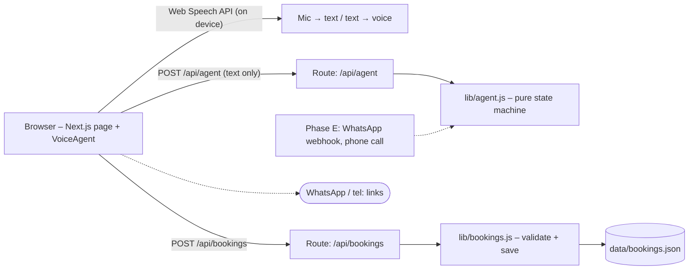
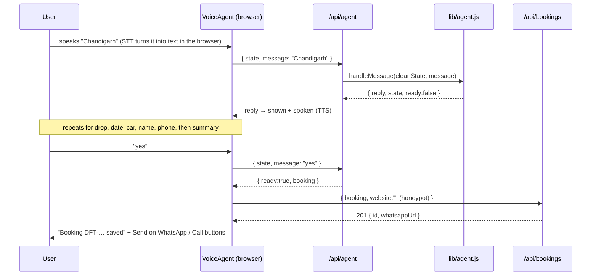

# Architecture — Dhruv Fine Trip

**Last updated:** 2026-11-02

## 1. System at a glance



| Part | Tech | Runs where | Port (dev / tests) |
|---|---|---|---|
| Website + API | Next.js (App Router, JavaScript) | Node | 3000 / 3100 |
| Voice | Web Speech API (`SpeechRecognition`, `speechSynthesis`) | Browser | — |
| Storage | JSON file (phase B), MongoDB Atlas later if hosted on Vercel | Server | — |

## 2. Folder structure

```
app/
  layout.js            metadata, JSON-LD, Header/Footer shell
  page.js              Home: sections in order
  globals.css          tokens + all styles (plain CSS)
  icon.svg             favicon (same mark as the logo)
  not-found.js
  api/agent/route.js   one conversation turn
  api/bookings/route.js  create (public) / list (admin)
components/            Header, Footer, Logo, VoiceAgent ('use client')
lib/
  business.js          single source of business data + whatsappLink()
  agent.js             conversation logic, no I/O, shared by every channel
  bookings.js          validateBooking(), saveBooking(), listBookings()
  rateLimit.js         tiny in-memory limiter
public/logo.svg
tests/
  agent.test.js        node --test
  bookings.test.js
  e2e/e2e-home.mjs     Playwright: sections, CTAs, typed booking flow
  e2e/regress.sh
docs/                  PROJECT_PLAN.md, blueprint.html, ARCHITECTURE.md
```

## 3. Request / data flow

One booking, end to end:



## 4. Rules every layer follows

- **Thin routes, logic in `lib/`.** Routes parse JSON, call one function and return JSON. `lib/agent.js` has no `fetch`, `fs` or `window`, so the website, WhatsApp and phone channels can all reuse it.
- **The server is stateless.** Conversation state travels with each request, and the server **re-validates** it every time: the step comes from a whitelist and every field is a trimmed string with a maximum length. The client is never trusted.
- **Validation:** `/api/bookings` re-checks the full booking itself, even though the agent already did. That means required fields, phone `^[6-9]\d{9}$`, car from the fleet list, and length limits.
- **Errors:** routes return `{ error: "message" }` with 400, 401, 429 or 500. Stack traces are never sent.
- **Config:** `ADMIN_TOKEN` comes from server env only. If it is unset, `GET /api/bookings` stays disabled. No `NEXT_PUBLIC_*` secrets.
- **Client:** every UI state is handled: idle, listening, thinking, speaking, error, unsupported and permission denied.

## 5. Data model

`BOOKING { id, pickup, drop, date, car, name, phone, createdAt }`, kept as an array in `data/bookings.json` (gitignored).
`ponytail: single JSON file with no locking. Move to MongoDB when bookings or hosting need it.`

## 6. Security decisions

| Topic | Decision |
|---|---|
| Auth | None for visitors. The owner list uses `x-admin-token` against env `ADMIN_TOKEN`, compared in constant time |
| Rate limits | In-memory per IP: `/api/agent` 60/min, `/api/bookings` 5/10min |
| Spam | Honeypot field `website` on booking create |
| Input | Max lengths on all strings; message ≤ 300 chars; JSON body only |
| Privacy | Audio never leaves the browser; only text is sent. Phone numbers are stored server-side only |
| Headers | Next defaults + `X-Content-Type-Options`, `Referrer-Policy` via `next.config.mjs` |

## 7. Test strategy

| Level | Tool | Where | Runs against |
|---|---|---|---|
| Unit | `node --test` (built in, no dependency) | `tests/*.test.js` | `lib/agent.js`, `lib/bookings.js` with a temp data file |
| Browser E2E | `playwright-core` + installed Edge/Chrome | `tests/e2e/e2e-home.mjs` | `next start` on port 3100, `BOOKINGS_FILE` pointing to a temp file |
| Regression | `tests/e2e/regress.sh` | — | build → unit → E2E, one at a time |

The mic can't be tested headless, so E2E drives the **typed** flow, which uses the same code path after speech-to-text. The voice layer is checked by hand in Chrome, and that is reported as manual.

## 8. Deployment

`npm run build` → `npm start`. Set `ADMIN_TOKEN` on the host. HTTPS is required for the microphone, though `localhost` is fine in dev. Host choice is still open (see PROJECT_PLAN §10).
