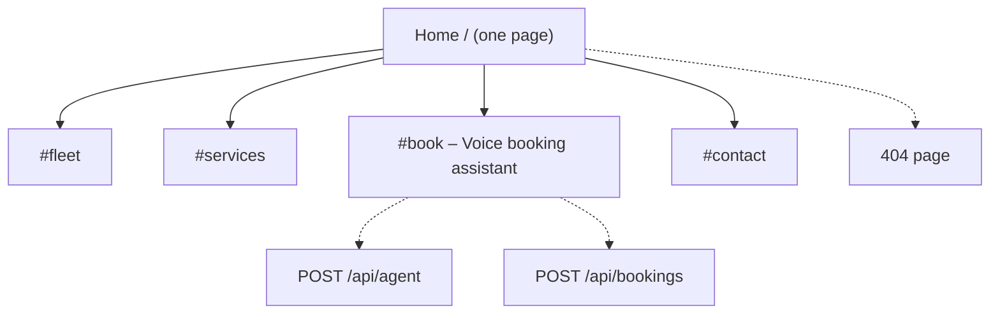
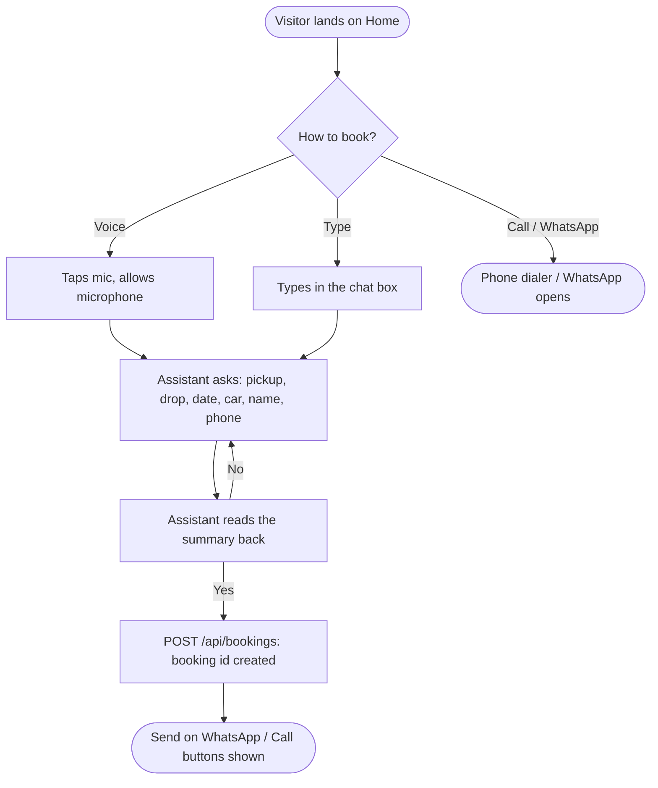
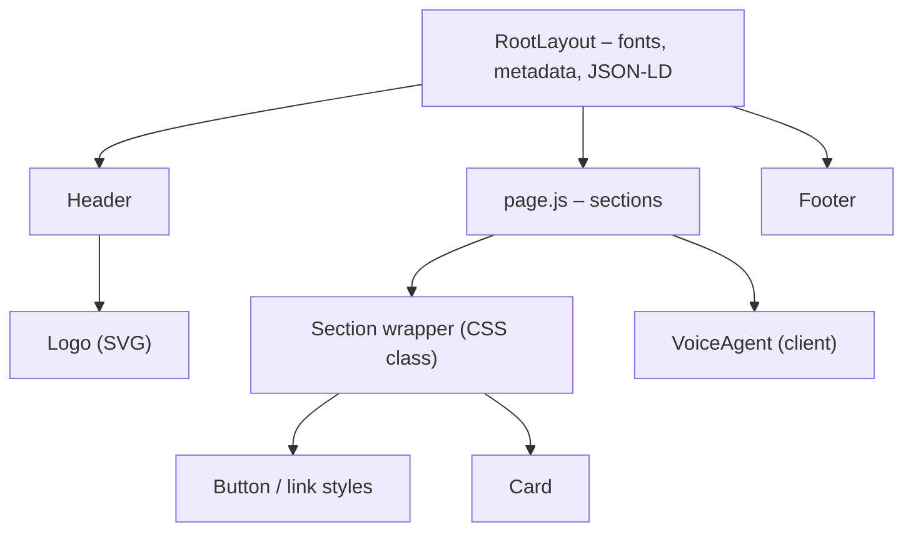
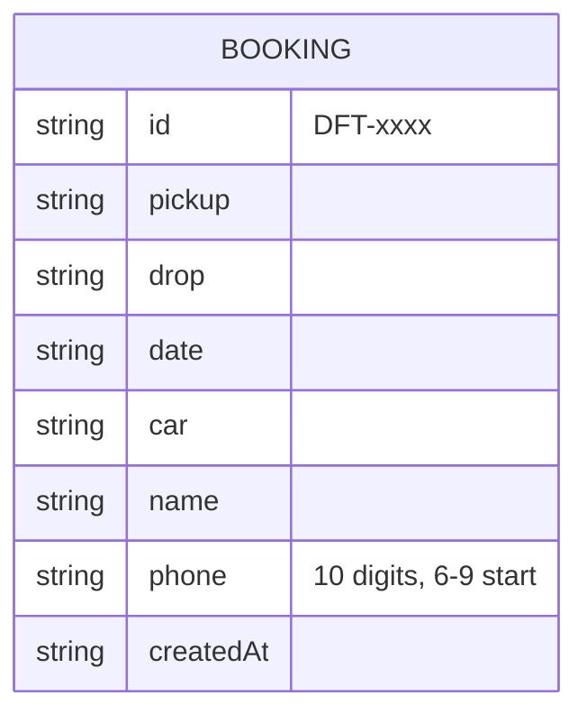

# Project Plan — Dhruv Fine Trip

**Status:** Phase A · **Last updated:** 2026-11-02 · **Next step:** 5 – Layout shell

> How to use this file: it is the single source of truth for what gets built and in which order.
> Work happens **one step at a time**: pick the next `todo` → build only that → test (skill `regression-testing`) → cleanup → mark `done` with notes → the user commits.
> If the plan changes, update this file (and `docs/blueprint.html`, `docs/ARCHITECTURE.md`) first, then code.

## 1. Overview

- **What:** a one-page website for Dhruv Fine Trip, a small taxi service in Zirakpur (Mohali, Punjab). The site includes a voice booking assistant that runs in the browser.
- **For whom:** travellers on Chandigarh ⇄ Delhi, Himachal Pradesh and Chardham Yatra routes, plus daily pick-and-drop customers. Most of them are on mobile.
- **Primary goal / CTA:** a booking request. The visitor can talk or type to the assistant, or tap **Call** or **WhatsApp**. Every confirmed booking ends as a pre-filled WhatsApp message to the owner.
- **Stack:** Next.js (App Router) in **JavaScript**, with no TypeScript. Styling is plain CSS with variables, so there is no Tailwind or UI library. Voice uses the browser **Web Speech API** for speech-to-text and text-to-speech. It is free and needs no API key.
- **Deadline:** none given.
- **Ground rules:** ponytail by default, which means no new dependency unless a step needs one. API routes stay thin and the logic lives in `lib/`. The user makes every commit.
- **Architecture:** see `docs/ARCHITECTURE.md`

### Business data (from the client's WhatsApp card)
| Field | Value |
|---|---|
| Name | Dhruv Fine Trip |
| Fleet | Toyota Innova Crysta (7+1) · New Maruti Ertiga (6+1) · Toyota Etios (4+1) · Swift Dzire (4+1) · Tempo Traveller |
| Services | One-way taxi · Chandigarh–Delhi–Chandigarh · Himachal Pradesh · Daily pick & drop · Chardham Yatra · all routes |
| Address | 65 Phase-1, Ravindra Enclave, Baltana, Zirakpur, Dist. SAS Nagar (Mohali), Punjab |
| Phones | 7310224488 · 9621110066 |

## 2. Sitemap



## 3. Pages and sections

### Home `/`
| # | Section | Purpose | Content needed | Components | Links / CTAs go to |
|---|---|---|---|---|---|
| 1 | Header | Brand + nav + quick call | Logo | Logo, Button | #fleet, #services, #book, tel: |
| 2 | Hero | Main promise + CTAs | Headline: reliable taxi, all routes incl. Chardham | Button | #book, tel:, WhatsApp |
| 3 | Fleet | Show the 5 vehicles | Name, seats | Card | #book (car pre-selected by voice) |
| 4 | Services / routes | One-way, Chd–Delhi, Himachal, Daily, Chardham | Short text each | Card | #book |
| 5 | Book (voice assistant) | Talk or type to book | Greeting, questions | VoiceAgent | /api/agent, /api/bookings, WhatsApp |
| 6 | Contact | Address, phones, map | Address, 2 numbers | Button | tel:, WhatsApp, Google Maps |
| 7 | Footer | Name, address, © | — | Logo | — |

## 4. Section interlink map

```mermaid
flowchart LR
    subgraph HOME["Home"]
        h_header["Header"] --> h_hero["Hero"] --> h_fleet["Fleet"] --> h_svc["Services"] --> h_book["Voice booking"] --> h_contact["Contact"] --> h_footer["Footer"]
    end
    h_hero -.-> h_book
    h_fleet -.-> h_book
    h_svc -.-> h_book
    h_header -.-> call(["tel: 7310224488"])
    h_hero -.-> wa(["WhatsApp chat"])
    h_book -.-> wa
    h_contact -.-> call
    h_contact -.-> map(["Google Maps"])
```

## 5. User flows



## 6. Shared components (build before sections)



## 7. Data & API map



| Endpoint | Method | Auth | Used by |
|---|---|---|---|
| `/api/agent` | POST `{ state, message }` → `{ reply, state, ready }` | public, rate-limited | VoiceAgent: one conversation turn |
| `/api/bookings` | POST `{ booking }` → `{ id, whatsappUrl }` | public, validated, rate-limited, honeypot | VoiceAgent: confirmed booking |
| `/api/bookings` | GET → list | `ADMIN_TOKEN` header | Owner only |

Storage in phase B: `data/bookings.json` on the server. It works on a VPS or local machine but **not** on Vercel. See open questions.

## 8. Design decisions

- **Direction skill:** `minimalist-ui`: clean and calm, with a lot of whitespace. It stays readable for older pilgrims too.
- **Tokens:** navy `#0F2A44` (trust) · taxi yellow `#F5B700` (accent / CTA) · off-white `#F8F7F4` · text `#1A1A1A`. Font: **Inter** only, self-hosted via next/font, with a Helvetica fallback. The user asked for a simple, professional font, not trendy AI-looking ones (Instrument Serif and Geist were removed on 2026-11-02). Spacing scale is 4/8px and the radius is 12px. **Light theme only** (user decision, 2026-11-02).
- **Logo:** built with the `logo-design` skill. Concepts are in `docs/logo-options.html` and the SVGs in `docs/logo/`. The chosen mark becomes the favicon (`app/icon.svg`), the header logo and the OG image. The first draft (star, mountains and road) was dropped because it looked generic.
- **Animation library (one):** none. CSS transitions only, and `prefers-reduced-motion` is respected.
- **Component source:** our own components, which is a small set.

### Voice rules (the assistant follows all of these)
1. **The mic starts only on a user tap.** It never auto-starts on page load, and the browser asks for permission once.
2. **One question at a time**, and every reply is 1–2 short sentences.
3. **No talking over the user.** Speech stops the moment the mic opens. After a voice answer, the mic re-opens automatically once the assistant finishes speaking (hands-free mode). After a typed answer it does not.
4. **Everything is also on screen.** The transcript shows every turn, live interim text appears while listening, and typing works the same as speaking.
5. **Read back before saving.** The full summary is read out, and the booking is created only after a clear "yes".
6. **Numbers are read digit by digit** (7 3 1 0 …), and phone numbers are validated as 10 digits starting with 6–9.
7. **There is always a way out.** "Start over" or "cancel" resets the flow, a Stop button ends both speech and listening, and Call and WhatsApp are always visible.
8. **The assistant never promises a price.** Fares are confirmed by the team on call or WhatsApp.
9. **No silent failures.** If the mic is not supported or permission is denied, the assistant says so and falls back to typing.
10. **Privacy:** no audio is sent to our server, only the text. This is said under the mic button.
11. **Language:** `en-IN` voice by default, with a toggle for `hi-IN` (Hindi) in Phase C.

## 9. Build order

### Phase A — Foundation
| # | Step | Status | Done on | Notes |
|---|---|---|---|---|
| 1 | Setup: Next.js JS scaffold, `jsconfig`, `.env.example`, folders per ARCHITECTURE.md | done | 2026-11-02 | Next 16.4.4 + React 19.3.1, security headers in `next.config.mjs`; `next build` ok |
| 2 | Test harness: `node --test` for `lib/`, Playwright (`playwright-core`) E2E, `tests/e2e/regress.sh` | done | 2026-11-02 | `tests/e2e/e2e-home.mjs` (7 checks, port 3100, Edge) + `regress.sh`. Suite correctly fails on the missing favicon (404), which step 4 fixes |
| 3 | Design foundation: tokens in `app/globals.css`, light theme, focus styles | done | 2026-11-02 | `minimalist-ui` direction; fonts via next/font (now Inter only); tokens, buttons, card, skip link, reduced motion. Dark mode removed (light only). Build ok, phone has no horizontal scroll |
| 4 | Logo: `public/logo.svg` + `app/icon.svg` + `Logo` component | done | 2026-11-02 | User picked **d1 Road badge** (A+C combination) after 3 rounds; roof sign redrawn as a trapezoid so it no longer reads as a jar lid. Built with the `logo-design` skill (kaankiziltug, MIT). Favicon `app/icon.svg`, `public/logo.svg`, `components/Logo.js` (inline mark + live-text name). E2E 9/9; mutation (favicon removed) caught, 2 fails |
| 5 | Layout shell: Header (mobile menu), Footer, `lib/business.js` (single data source), 404 | todo | | |
| 6 | Phase A regression | todo | | |

### Phase B — Website sections
| # | Step | Status | Done on | Notes |
|---|---|---|---|---|
| 7 | Hero (Call / WhatsApp / Book CTAs) | todo | | |
| 8 | Fleet section | todo | | |
| 9 | Services & routes section | todo | | |
| 10 | Contact section (tel, WhatsApp, map link) | todo | | |
| 11 | Phase B regression | todo | | |

### Phase C — Voice booking assistant
| # | Step | Status | Done on | Notes |
|---|---|---|---|---|
| 12 | `lib/agent.js`: pure conversation state machine plus unit tests covering every step, "start over", bad phone and FAQ | todo | | |
| 13 | `POST /api/agent`: validates input, whitelists state, rate limit | todo | | |
| 14 | `lib/bookings.js` + `POST/GET /api/bookings`: validation, honeypot, admin token, WhatsApp link | todo | | |
| 15 | `VoiceAgent` UI: transcript, text input, mic + Stop, interim text, states (idle/listening/thinking/speaking/error) | todo | | |
| 16 | Voice layer: Web Speech STT + TTS, hands-free re-listen, digit-by-digit numbers, unsupported/denied fallback | todo | | |
| 17 | Hindi (`hi-IN`) voice toggle | todo | | |
| 18 | Phase C regression | todo | | |

### Phase D — Polish & launch
| # | Step | Status | Done on | Notes |
|---|---|---|---|---|
| 19 | SEO: metadata, OG image, LocalBusiness JSON-LD, robots + sitemap | todo | | |
| 20 | Motion & polish: CSS only, reduced-motion respected | todo | | |
| 21 | Launch readiness audit + final regression | todo | | |

### Phase E — Phone & WhatsApp agent (later, needs paid services)
The plan is to start the same assistant on a **phone call** or a **WhatsApp chat**. `lib/agent.js` is pure and has no browser code, so these channels reuse it unchanged.
| # | Step | Status | Done on | Notes |
|---|---|---|---|---|
| 22 | WhatsApp Cloud API webhook `/api/whatsapp`: text messages go through `lib/agent.js` (needs a Meta Business account + number) | todo | | |
| 23 | Phone calls via Exotel / Twilio Voice: call goes to their STT, then `lib/agent.js`, then their TTS (needs a paid number) | todo | | |
| 24 | Owner notification on new booking (WhatsApp template / SMS) | todo | | |
| 25 | Phase E regression | todo | | |

Status values: `todo` · `in progress` · `done` · `blocked (<reason>)`

## 10. Open questions & risks

- **Hosting:** Vercel, or a VPS / Hostinger Node? On Vercel, `data/bookings.json` will not persist, so we would need MongoDB Atlas (free tier). Recommendation: start with WhatsApp hand-off plus the JSON file, and move to MongoDB when hosting is fixed. Owner: user.
- **Which number gets WhatsApp bookings?** 7310224488 is assumed. Owner: user.
- **Photos:** real photos of their cars would look much better than icons. Can the client send some? Owner: user.
- **Browser support:** Web Speech recognition works in Chrome, Edge and Android Chrome, but not in Firefox. On iOS Safari support is partial. Typing always works as the fallback.
- **Phase E costs:** a WhatsApp Business API number and an Exotel/Twilio number are paid and need the client's KYC.
