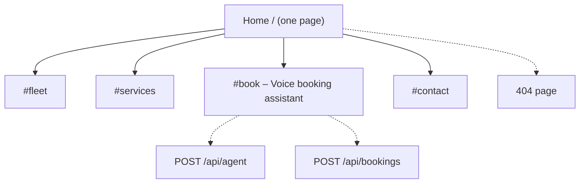
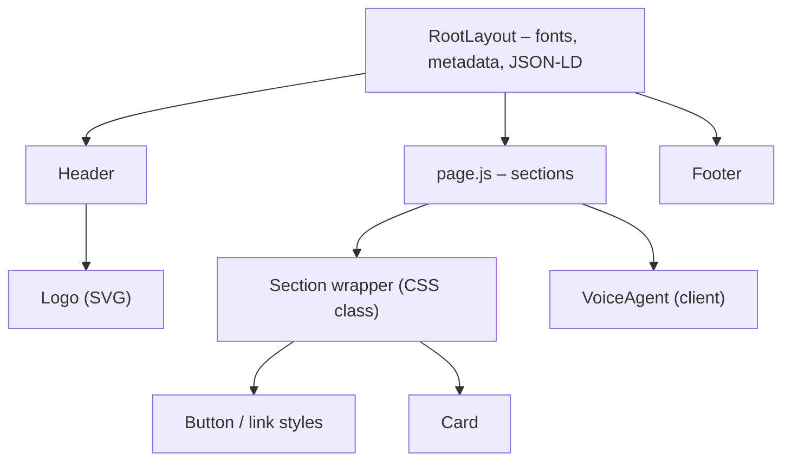
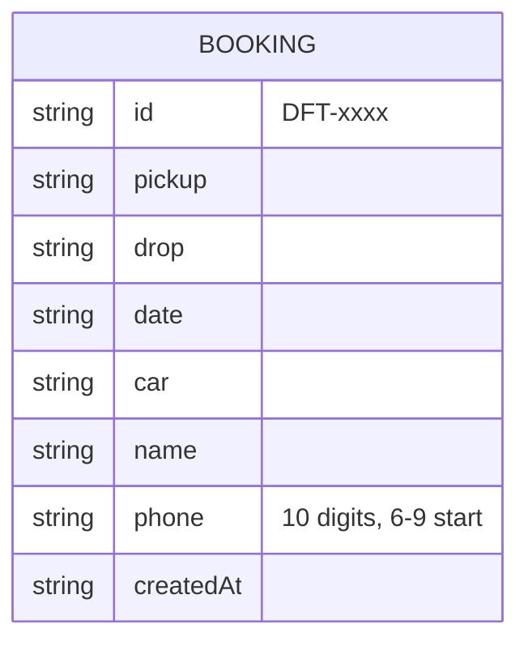

# Project Plan — Dhruv Fine Trip

**Status:** Phase B3 done (waiting for review) · **Last updated:** 2026-11-07 · **Next step:** B4.5 – micro interactions, then B4.6 regression; B4.10 waits for the user

> How to use this file: it is the single source of truth for what gets built and in which order.
> Work happens **one step at a time**: pick the next `todo` → build only that → test (skill `regression-testing`) → cleanup → mark `done` with notes → the user commits.
> If the plan changes, update this file (and `docs/blueprint.html`, `docs/ARCHITECTURE.md`) first, then code.

## 1. Overview

- **What:** a one-page website for Dhruv Fine Trip, a small taxi service in Zirakpur (Mohali, Punjab). The site includes a voice booking assistant that runs in the browser.
- **For whom:** travellers on Chandigarh ⇄ Delhi, Himachal Pradesh and Chardham Yatra routes, plus daily pick-and-drop customers. Most of them are on mobile.
- **Primary goal / CTA:** a booking request. The visitor can talk or type to the assistant, or tap **Call** or **WhatsApp**. Every confirmed booking ends as a pre-filled WhatsApp message to the owner.
- **Stack:** Next.js (App Router) in **JavaScript**, with no TypeScript. Styling is plain CSS with variables, so there is no Tailwind or UI library. Voice uses the browser **Web Speech API** for speech-to-text and text-to-speech. It is free and needs no API key.
- **Deadline:** none given.
- **Ground rules:** ponytail by default, which means no new dependency unless a step needs one. API routes stay thin and the logic lives in `lib/`. The user makes every commit.
- **Architecture:** see `docs/ARCHITECTURE.md`

### Business data (from the client's WhatsApp card)
| Field | Value |
|---|---|
| Name | Dhruv Fine Trip |
| Fleet | Toyota Innova Crysta (7+1) · New Maruti Ertiga (6+1) · Toyota Etios (4+1) · Swift Dzire (4+1) · Tempo Traveller |
| Services | One-way taxi · Chandigarh–Delhi–Chandigarh · Himachal Pradesh · Daily pick & drop · Chardham Yatra · all routes |
| Address | 65 Phase-1, Ravindra Enclave, Baltana, Zirakpur, Dist. SAS Nagar (Mohali), Punjab |
| Phones | 7310224488 · 9621110066 |

## 2. Sitemap



## 3. Pages and sections

### Home `/`
| # | Section | Purpose | Content needed | Components | Links / CTAs go to |
|---|---|---|---|---|---|
| 1 | Header | Brand + nav + quick call | Logo | Logo, Button | #fleet, #services, #book, tel: |
| 2 | Hero | Main promise + CTAs | Headline: reliable taxi, all routes incl. Chardham | Button | #book, tel:, WhatsApp |
| 3 | Fleet | Show the 5 vehicles | Name, seats | Card | #book (car pre-selected by voice) |
| 4 | Services / routes | One-way, Chd–Delhi, Himachal, Daily, Chardham | Short text each | Card | #book |
| 5 | Book (voice assistant) | Talk or type to book | Greeting, questions | VoiceAgent | /api/agent, /api/bookings, WhatsApp |
| 6 | Contact | Address, phones, map | Address, 2 numbers | Button | tel:, WhatsApp, Google Maps |
| 7 | Footer | Name, address, © | — | Logo | — |

## 4. Section interlink map

```mermaid
flowchart LR
    subgraph HOME["Home"]
        h_header["Header"] --> h_hero["Hero"] --> h_fleet["Fleet"] --> h_svc["Services"] --> h_book["Voice booking"] --> h_contact["Contact"] --> h_footer["Footer"]
    end
    h_hero -.-> h_book
    h_fleet -.-> h_book
    h_svc -.-> h_book
    h_header -.-> call(["tel: 7310224488"])
    h_hero -.-> wa(["WhatsApp chat"])
    h_book -.-> wa
    h_contact -.-> call
    h_contact -.-> map(["Google Maps"])
```

## 5. User flows


## 6. Shared components (build before sections)



## 7. Data & API map



| Endpoint | Method | Auth | Used by |
|---|---|---|---|
| `/api/agent` | POST `{ state, message }` → `{ reply, state, ready }` | public, rate-limited | VoiceAgent: one conversation turn |
| `/api/bookings` | POST `{ booking }` → `{ id, whatsappUrl }` | public, validated, rate-limited, honeypot | VoiceAgent: confirmed booking |
| `/api/bookings` | GET → list | `ADMIN_TOKEN` header | Owner only |

Storage in phase B: `data/bookings.json` on the server. It works on a VPS or local machine but **not** on Vercel. See open questions.

## 8. Design decisions

- **Direction skill:** `minimalist-ui`: clean and calm, with a lot of whitespace. It stays readable for older pilgrims too.
- **Tokens:** navy `#0F2A44` (trust) · taxi yellow `#F5B700` (accent / CTA) · off-white `#F8F7F4` · text `#1A1A1A`. Font: **Inter** only, self-hosted via next/font, with a Helvetica fallback. The user asked for a simple, professional font, not trendy AI-looking ones (Instrument Serif and Geist were removed on 2026-11-02). Spacing scale is 4/8px and the radius is 12px. **Light theme only** (user decision, 2026-11-02).
- **Logo:** built with the `logo-design` skill. Concepts are in `docs/logo-options.html` and the SVGs in `docs/logo/`. The chosen mark becomes the favicon (`app/icon.svg`), the header logo and the OG image. The first draft (star, mountains and road) was dropped because it looked generic.
- **Animation library (one):** none. CSS transitions only, and `prefers-reduced-motion` is respected.
- **Component source:** our own components, which is a small set.

### Voice rules (the assistant follows all of these)
1. **The mic starts only on a user tap.** It never auto-starts on page load, and the browser asks for permission once.
2. **One question at a time**, and every reply is 1–2 short sentences.
3. **No talking over the user.** Speech stops the moment the mic opens. After a voice answer, the mic re-opens automatically once the assistant finishes speaking (hands-free mode). After a typed answer it does not.
4. **Everything is also on screen.** The transcript shows every turn, live interim text appears while listening, and typing works the same as speaking.
5. **Read back before saving.** The full summary is read out, and the booking is created only after a clear "yes".
6. **Numbers are read digit by digit** (7 3 1 0 …), and phone numbers are validated as 10 digits starting with 6–9.
7. **There is always a way out.** "Start over" or "cancel" resets the flow, a Stop button ends both speech and listening, and Call and WhatsApp are always visible.
8. **The assistant never promises a price.** Fares are confirmed by the team on call or WhatsApp.
9. **No silent failures.** If the mic is not supported or permission is denied, the assistant says so and falls back to typing.
10. **Privacy:** no audio is sent to our server, only the text. This is said under the mic button.
11. **Language:** `en-IN` voice by default, with a toggle for `hi-IN` (Hindi) in Phase C.

## 9. Build order

### Phase A — Foundation
| # | Step | Status | Done on | Notes |
|---|---|---|---|---|
| 1 | Setup: Next.js JS scaffold, `jsconfig`, `.env.example`, folders per ARCHITECTURE.md | done | 2026-11-02 | Next 16.4.4 + React 19.3.1, security headers in `next.config.mjs`; `next build` ok |
| 2 | Test harness: `node --test` for `lib/`, Playwright (`playwright-core`) E2E, `tests/e2e/regress.sh` | done | 2026-11-02 | `tests/e2e/e2e-home.mjs` (7 checks, port 3100, Edge) + `regress.sh`. Suite correctly fails on the missing favicon (404), which step 4 fixes |
| 3 | Design foundation: tokens in `app/globals.css`, light theme, focus styles | done | 2026-11-02 | `minimalist-ui` direction; fonts via next/font (now Inter only); tokens, buttons, card, skip link, reduced motion. Dark mode removed (light only). Build ok, phone has no horizontal scroll |
| 4 | Logo: `public/logo.svg` + `app/icon.svg` + `Logo` component | done | 2026-11-02 | User picked **d1 Road badge** (A+C combination) after 3 rounds; roof sign redrawn as a trapezoid so it no longer reads as a jar lid. Built with the `logo-design` skill (kaankiziltug, MIT). Favicon `app/icon.svg`, `public/logo.svg`, `components/Logo.js` (inline mark + live-text name). E2E 9/9; mutation (favicon removed) caught, 2 fails |
| 5 | Layout shell: Header (mobile menu), Footer, `lib/business.js` (single data source), 404 | done | 2026-11-02 | Sticky header (logo, nav, Call button, phone Menu that closes on Escape and on link click), footer (address with map link, both numbers, WhatsApp), 404 page, sticky footer. Unit 6/6, E2E 22/22. Mutations caught: Escape handler, WhatsApp encoding. Fixed after screenshots: phone header wrapping, footer gap |
| 6 | Phase A regression | done | 2026-11-02 | build ok · unit 6/6 · e2e-home 22/22 · 0 failing parts |

### Phase B — Website sections
| # | Step | Status | Done on | Notes |
|---|---|---|---|---|
| 7 | Hero (Call / WhatsApp / Book CTAs) | done | 2026-11-02 | `components/Hero.js`: promise headline, routes line, Book / Call / WhatsApp (pre-filled message) CTAs, "Book by voice" card linking to #book. E2E 28/28 (6 hero checks, CTAs above the fold on phone). Mutation (Book link) caught |
| 7b | Mobile pass (user: most visitors are on phones) | done | 2026-11-02 | Sticky bottom action bar (Call, WhatsApp, Book), phone header shows logo and Menu, thumb-sized hero buttons, anchored sections land below the header. E2E grew to 42 |
| 8 | Fleet section | done | 2026-11-02 | 5 cars from `lib/business.js` (unit test), drawn side-view icons for now, one column on phone. Mutation on scroll-margin caught after making the check deterministic |
| 9 | Services & routes section | done | 2026-11-02 | Merged into 11c (destinations gallery, nav Services lands there) |
| 10 | Contact section (tel, WhatsApp, map link) | done | 2026-11-02 | Call, WhatsApp and Visit cards plus a lazy keyless Google Maps embed (`mapEmbed` unit test). Phone: cards above the map. E2E 72/72 |
| 11a | Real car photos in Fleet (licence-checked) | done | 2026-11-02 | 5 Wikimedia Commons photos (1 public domain, 2 CC BY, 2 CC BY-SA), served through next/image. Etios photo with another taxi firm's logo rejected. Credits on the `/credits` page linked from the footer, which meets the CC attribution terms. Nav links changed to `/#section` so they work from any page. E2E 48/48 |
| 11b | Portfolio feel: hero with a large travel photo | done | 2026-11-02 | Full-bleed Lahaul hairpin road photo (Wikimedia, CC BY 4.0, resized to 2400px with sharp, credited on /credits). Dark scrim keeps white text readable; full screen height on desktop; yellow Book button, white outline Call and WhatsApp. Eager load with high fetch priority for LCP. E2E 52/52. Mutation (light scrim on phone) caught |
| 11c | Destinations gallery: Chardham, Himachal, Delhi, Chandigarh tricity, with photos | done | 2026-11-02 | 4 licence-checked Commons photos (1 CC0, 3 CC BY), resized with sharp. Phone: photo on top and text on a navy panel (short cards). Tablet and up: text over the photo on a scrim; desktop 2 large 4:3 columns (4 narrow ones crowded the text). `photoCredits()` feeds /credits (10 photos). Unit 9/9 (incl. no dashes in copy), E2E 60/60. Found and stopped an orphaned test server on 3102; suites now refuse to run on a busy port. No mutation for the layout change |
| 11d | How booking works (3 steps) + Why ride with us (only facts from the business card, no fake reviews or numbers) | done | 2026-11-02 | `components/HowItWorks.js` (numbered ol), `components/WhyUs.js` (4 reasons with own line icons), copy in `lib/business.js` with a no-dash unit test. Unit 10/10, E2E 67/67 incl. a tablet (820px) pass that caught a misplaced CSS rule |
| 11 | Phase B regression | done | 2026-11-02 | build ok · unit 11/11 · e2e-home 72/72 · 0 failing parts. Cleanup: no unused CSS classes, exports or debug leftovers |

### Phase B2 — More pages and interaction (planned 2026-11-07)
User asked for more pages, more interaction, "our packages" and "happy customers". Ground rules: no invented prices, policies or reviews. Packages are suggested trip plans (real routes, typical days, fare on request). Reviews appear only once the client sends real ones.
| # | Step | Status | Done on | Notes |
|---|---|---|---|---|
| B2.1 | Packages: `lib/packages.js`, `/packages` page, home teaser, nav link | done | 2026-11-07 | 3 suggested plans (Chardham, Do Dham, Shimla and Manali) with real routes as a timeline, typical days, suggested car, no prices; "Ask fare on WhatsApp" prefills the package; "Plan your own trip" card. 2 new CC BY photos. Credits moved to `lib/credits.js` (no circular import). Unit 13/13 (incl. no price in packages), new suite e2e-packages 18/18, e2e-home 72/72. Mutation (fare message without package name) caught by unit and E2E |
| B2.2 | Happy customers: `lib/reviews.js` (real reviews only), section, share CTA | done | 2026-11-07 | Empty today, so the section reads "Travelled with us?" with a prefilled WhatsApp share button and no cards; real reviews switch it to "What our customers say". `isPublishable()` (unit tested with good and bad samples; mutation caught) filters every review. Card layout checked with two temporary layout reviews that were removed straight after (verified). E2E home 75/75 |
| B2.2b | Customer trip photos (8, from the client, 2026-11-07) in a swipeable carousel (user: not a Pinterest grid) | done | 2026-11-07 | Replaced the first grid and dialog viewer with `components/PhotoCarousel.js`: CSS scroll snap (native swipe), photo in focus with neighbours peeking, arrows, dots, autoplay that stops on touch and never runs with reduced motion. Mutations caught: autoplay not stopping, reduced motion ignored, old narrow desktop slides. Earlier notes: Files moved to `public/images/customers/01..08.jpg` (no EXIF or GPS in them). Section now "Happy customers / Moments from our trips"; tap opens viewer with Previous, Next, arrow keys, Escape. Alt text says only what is in the photo. Unit test checks files, sizes and alt. Bugs found by screenshot and fixed: unreadable viewer buttons, empty bands around landscape photos (both now tested; both mutations caught). Client must have the families' permission, children appear in 3 photos |
| B2.3 | FAQ accordion (native details), answers only from known facts | done | 2026-11-07 | 7 questions built from `lib/business.js` (phones, fleet, address), no prices or invented policies; native details/summary (keyboard tested). Unit 15/15, E2E home 79/79 |
| B2.4 | Interaction: scroll reveal (reduced motion respected), fleet filter by group size, active nav link | done | 2026-11-07 | `components/PageEffects.js` (IntersectionObserver reveal with stagger, scroll spy for nav, aria-current on /packages) and `components/FleetFilter.js` (chips with aria-pressed, live count). Content stays visible if JS never runs. 3 mutations caught (filter stuck on all, reduced motion ignored, after making the test wait for effects). E2E home 97/97 |
| B2.6 | Client's real priced packages (2026-11-07): Kasol 3 days 2 nights Rs 17,000 per person all included; Kasol 4 days 3 nights Rs 13,900 per person; Manali 4 days 3 nights Rs 16,500 per person | done | 2026-11-07 | Tours (priced, client data) and plans (fare on request) split in `lib/packages.js`; `formatPrice` shows ₹17,000 style (unit tested incl. lakh grouping). Home teaser shows the 3 tours with prices; /packages has Tour packages then Yatra and trip plans. 2 new Kasol photos (CC BY), credits now 14. No itinerary invented for the tours. Unit 21/21, e2e-packages 21/21. Prices now come from the client, so the "no price" tests change on purpose. Kasol 4D is cheaper than 3D: confirm with the client |
| B2.5 | Phase B2 regression | done | 2026-11-07 | build ok · unit 21/21 · e2e-home 98/98 · e2e-packages 21/21 · 0 failing parts. Cleanup: no unused CSS, exports or debug leftovers |
| B2.7 | Fix: carousel photo in focus stuck at the left edge on wide screens (user report with screenshot) | done | 2026-11-07 | Cause: slide offsetLeft was measured from the page, not the track, so centring and active detection were off by the container margin (a full slide on 1900px screens). Fix: `.carousel-track { position: relative }`; stronger pop out (neighbours scale 0.86, opacity 0.45). New checks centre the active photo after every move, also at 1920px; they fail without the fix (3 fails) and pass with it. Also: nav highlight now clears in sections without a nav link (mutation caught). e2e-home 103/103, e2e-packages 21/21, unit 21/21 |

### Phase B3 — Booking form (planned 2026-11-07)
Voice booking is deferred, so every Book button needs a working target. A short form that opens WhatsApp with the details filled in: no AI, no server, no cost. Voice can sit on top of it later.
| # | Step | Status | Done on | Notes |
|---|---|---|---|---|
| B3.1 | `lib/booking.js`: validate the fields and build the WhatsApp message (unit tested) | done | 2026-11-07 | Pickup required, drop required unless a package, date required and not in the past, people 1 to 50; message lists only filled details, package bookings leave out the trip type. 9 unit tests; 3 mutations caught (past date, drop with package, trip type in package message) |
| B3.2 | `#book` section with the form; Book buttons prefill it; every "by voice" promise replaced | done | 2026-11-07 | `components/BookSection.js` + `components/BookingForm.js` (labels, inline errors with aria, focus on first error, 48px inputs at 16px, success state with "Open WhatsApp again"). Prefill: data-book-* on cars and destinations, `/?package=` from /packages. Hero card now "Book in a minute", calendar icon on the phone Book button, FAQ, steps and 404 copy updated. New suite e2e-booking 29/29 (WhatsApp is recorded, never opened). Screenshot found date and time going out of line on error; fixed and tested |
| B3.3 | Phase B3 regression | done | 2026-11-07 | build ok · unit 30/30 · e2e-booking 29/29 · e2e-home 103/103 · e2e-packages 22/22 · 0 failing parts |

### Phase B4 — Premium polish (planned 2026-11-07)
User: a grey shadow around the carousel photo looks wrong, the site does not feel premium or interactive enough, and a reload should land at the top of the page. Rules from `premium-interaction-craft`: transform and opacity only, hover only on pointer devices, one set of timing tokens, reduced motion respected.
| # | Step | Status | Done on | Notes |
|---|---|---|---|---|
| B4.1 | Remove the carousel shadow; reload always starts at the top of the page | done | 2026-11-07 | Shadow removed (it was clipped by the track into a grey box). Inline head script: manual scroll restoration, and on a reload the old #hash is dropped and the page starts at the top; fresh links like /#book still land on the section. New suite e2e-polish 6/6; mutation (no script) caught 3 fails |
| B4.7 | Facebook page link (user, 2026-11-07) in footer and contact | done | 2026-11-07 | https://www.facebook.com/share/18bo2AcbGZ/ |
| B4.2 | Header transparent over the hero photo, solid after scrolling | done | 2026-11-07 | Hero slides under the sticky header (`--header-h`), full screen on desktop; white logo and links, yellow Call and tagline over the photo; solid after 24px; phone menu forces the solid header. Initial state set by the head script (no flash), kept in sync by PageEffects. Mutation (menu rule) caught |
| B4.8 | Gentle smooth scrolling (user, 2026-11-07) and mobile hardening | done | 2026-11-07 | `lenis` 1.3.27 via `components/SmoothScroll.js`: wheel easing on desktop, native touch on phones, off with reduced motion, anchors honour scroll-margin (a double offset was found and fixed; mutation caught). CSS scroll-behavior removed. Fleet chips wrap on phones. No sideways scroll or off-screen element on /, /packages, /credits, 404 at 360, 375 and 390px; equal 64px section spacing on phones |
| B4.3 | Hero entrance (staggered) and a slow photo zoom | done | 2026-11-07 | CSS only (runs without JS): copy rises 80ms apart, card last, photo settles from 108% over 18s. The new 360/375/390px check caught the zoom causing sideways scroll; fixed with overflow hidden on the photo layer. Reduced motion instant |
| B4.4 | Moving strip of real routes under the hero | done | 2026-11-07 | `components/RouteStrip.js`: 12 places from `lib/business.js`, seamless CSS loop, pauses on hover, read once by screen readers, still and wrapped with reduced motion (mutation caught). No sideways page scroll |
| B4.9 | Professional phone numbers (user, 2026-11-07) | done | 2026-11-07 | `formatPhone` shows +91 73102 24488 everywhere; hero button reads "Call now" so it fits half a phone width. Unit 30/30, e2e-home 104/104 |
| B4.10 | Photo credits (user asked to remove them) | blocked (waiting for the user) | | Most photos are CC BY or CC BY-SA, which require credit. Options: keep a small footer link, swap to CC0/public domain photos, or use the client's own photos |
| B4.5 | Button and card micro interactions with motion tokens | todo | | |
| B4.6 | Phase B4 regression | todo | | |

### Phase C — Voice booking assistant (deferred by the user on 2026-11-07)
Options discussed: A rule-based (free), B full LLM, C mix (rule-based flow in code plus an LLM only to pull details out of free Hinglish speech, behind an env flag). Recommended C. Decide when this phase starts.
| # | Step | Status | Done on | Notes |
|---|---|---|---|---|
| 12 | `lib/agent.js`: pure conversation state machine plus unit tests covering every step, "start over", bad phone and FAQ | todo | | |
| 13 | `POST /api/agent`: validates input, whitelists state, rate limit | todo | | |
| 14 | `lib/bookings.js` + `POST/GET /api/bookings`: validation, honeypot, admin token, WhatsApp link | todo | | |
| 15 | `VoiceAgent` UI: transcript, text input, mic + Stop, interim text, states (idle/listening/thinking/speaking/error) | todo | | |
| 16 | Voice layer: Web Speech STT + TTS, hands-free re-listen, digit-by-digit numbers, unsupported/denied fallback | todo | | |
| 17 | Hindi (`hi-IN`) voice toggle | todo | | |
| 18 | Phase C regression | todo | | |

### Phase D — Polish & launch
| # | Step | Status | Done on | Notes |
|---|---|---|---|---|
| 19 | SEO: metadata, OG image, LocalBusiness JSON-LD, robots + sitemap | todo | | |
| 20 | Motion & polish: CSS only, reduced-motion respected | todo | | |
| 21 | Launch readiness audit + final regression | todo | | |

### Phase E — Phone & WhatsApp agent (later, needs paid services)
The plan is to start the same assistant on a **phone call** or a **WhatsApp chat**. `lib/agent.js` is pure and has no browser code, so these channels reuse it unchanged.
| # | Step | Status | Done on | Notes |
|---|---|---|---|---|
| 22 | WhatsApp Cloud API webhook `/api/whatsapp`: text messages go through `lib/agent.js` (needs a Meta Business account + number) | todo | | |
| 23 | Phone calls via Exotel / Twilio Voice: call goes to their STT, then `lib/agent.js`, then their TTS (needs a paid number) | todo | | |
| 24 | Owner notification on new booking (WhatsApp template / SMS) | todo | | |
| 25 | Phase E regression | todo | | |

Status values: `todo` · `in progress` · `done` · `blocked (<reason>)`

## 10. Open questions & risks

- **Hosting:** Vercel, or a VPS / Hostinger Node? On Vercel, `data/bookings.json` will not persist, so we would need MongoDB Atlas (free tier). Recommendation: start with WhatsApp hand-off plus the JSON file, and move to MongoDB when hosting is fixed. Owner: user.
- **Which number gets WhatsApp bookings?** 7310224488 is assumed. Owner: user.
- **Photos:** real photos of their cars would look much better than icons. Can the client send some? Owner: user.
- **Browser support:** Web Speech recognition works in Chrome, Edge and Android Chrome, but not in Firefox. On iOS Safari support is partial. Typing always works as the fallback.
- **Phase E costs:** a WhatsApp Business API number and an Exotel/Twilio number are paid and need the client's KYC.
